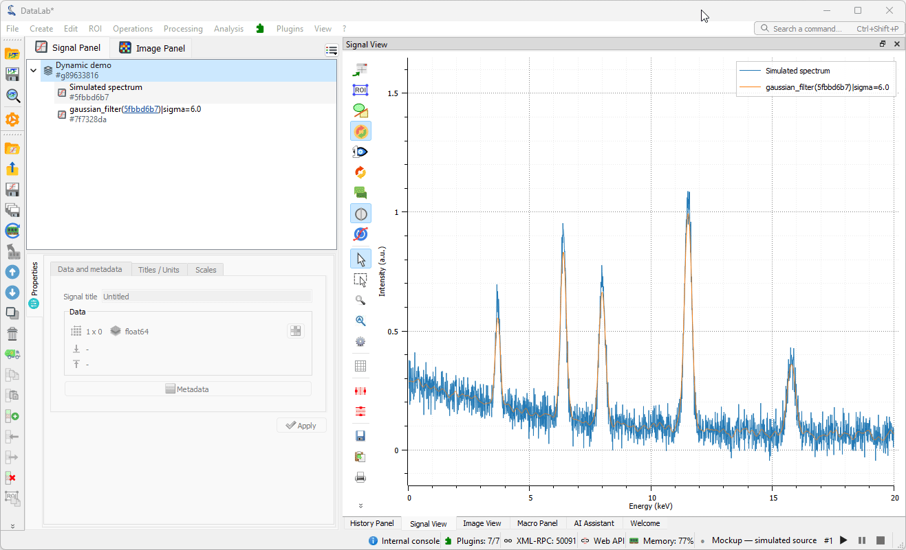

# DataLab dynamic mode demo

Mockup of a **dynamic mode** for DataLab: a signal fed by a live source is updated as frames are acquired, and a processing result follows it automatically, while both objects keep their identity in the workspace.

This is a **mockup with a simulated source**, not a DataLab feature: it relies on internal DataLab APIs of the `develop` branch and is shared as a demonstration to discuss what a dynamic mode could look like.

<picture>
  <source media="(prefers-color-scheme: dark)" srcset="doc/demo/demo-dark.gif">
  
</picture>

*The demo in DataLab: a Gaussian filter is applied once to the simulated spectrum and its result is followed; once the live update is started from the status bar indicator (bottom right), the raw spectrum (blue) and its filtered result (orange) are updated together, in place, on each frame. The settings popup, opened from the indicator, changes the filter σ and the main peak while the live update runs.*

## What it shows

- A simulated spectrum (fixed peaks and a drifting main peak on a decaying background, 2048 points) read every 200 ms.
- The Gaussian filter, applied by the normal DataLab path, recomputed on each frame in a process of its own: DataLab's processing pool is never used nor interrupted.
- The raw spectrum and its filtered result updated in place, together, in DataLab's own panels; the filter sigma and the source settings can be changed while the live update runs.
- Start, pause, resume and stop, with a bounded load: one read and one computation at a time, and only the latest frame waiting.

## Launching

From the root of the DataLab repository (its `.env` file sets the development environment):

```powershell
python scripts/run_with_env.py python ..\datalab-dynamic-demo\scripts\launch_demo.py
```

The launcher adds this project folder to the `DATALAB_PLUGINS` environment variable for this session only: the user configuration is not modified. Third-party plugins must be enabled in DataLab (**Plugins > Configure plugins...**), and the plugin must not be disabled there.

To show DataLab in French, add `--lang fr` to the command; the labels of the plugin stay in English.

## Walkthrough

1. **Plugins > Dynamic mode demo > Create simulated source**: the *Simulated spectrum* signal is added in a *Dynamic demo* group, and the live update indicator appears in the status bar. The computation process starts at the same time (it takes a few seconds).
2. With the spectrum selected, apply **Processing > Noise reduction > Gaussian filter** (for instance σ = 6).
3. With the result selected, use **Plugins > Dynamic mode demo > Follow this result**.
4. Select the *Dynamic demo* group to overlay the raw and filtered curves.
5. Click ▶ in the indicator (or **Start live update** in the menu): both curves are updated in place.
6. Click the indicator label to open the settings: change the filter σ, the amplitude or the position of the main peak, the noise level or the read period while the live update runs.
7. ⏸ pauses (both curves are frozen), ▶ resumes, ⏹ stops and releases the computation process; the last coherent pair of curves is kept.

## Controls

The demo adds no dock and no floating window:

- **Status bar indicator**, shown once the source exists: state dot (green live, orange paused, grey ready or stopped, red error), *Mockup — simulated source* label, number of the last published frame (or *starting computation process…*), and start/resume, pause and stop buttons. Its tooltip gives the source, the read period, the followed result and the last message.
- **Settings popup**, opened by a click on the label and closed by a click elsewhere: filter σ, main peak amplitude and position, noise level, read period, and counters (frames read and skipped, results published and discarded, duration of the last computation).
- **Plugins > Dynamic mode demo** menu: the same commands, usable from the keyboard.

Keep **View > Auto-refresh** checked: when it is off, the objects are still updated but the plots are not redrawn (the indicator then shows *display suspended*).

## How it works

```text
core/source.py       simulated spectrum, read-only frames with source and reception times
core/regulation.py   state machine: bounded reads and computations, task keys
adapters/executor.py one-process spawn pool, independent of DataLab's pool
adapters/controller.py  link, timers, worker thread reads, in-place publication
adapters/widgets.py  status bar indicator and settings popup
adapters/desktop.py  plugin class and Plugins menu
```

Each computation is identified by a key (session generation, parameter revision, frame number): a result is published only if the live update was not paused, stopped or failed meanwhile and if the parameters did not change. A result is published even if a more recent frame is waiting, so that the display keeps moving when the computation is slower than the source. The raw frame and its result are always published together.

Every object and panel change happens in the GUI thread. Plots are refreshed for the selection only and without forcing, so that DataLab's Auto-refresh setting is respected; workspace modification notifications are sent at most once per second, and the Properties panel is refreshed on pause and stop only.

The source signal records its origin with Sigima's `experimental_source` metadata (`kind="simulator"`, `location="demo://dynamic/signal"`, `entry="waveform"`, source and reception times, frame number). The result keeps the processing parameters of the last published frame, so that DataLab can apply it again from the Processing tab.

## Limitations

- One 1D source, one processing (the Gaussian filter) and a simulated source only.
- The state of the live update is not shown in the object list: DataLab offers no extension point for that.
- Editing the parameters of the followed result in DataLab's Processing tab while the live update runs pauses it; resuming adopts the new parameters.
- Deleting the source or the result stops the live update; nothing is recreated implicitly.
- Frames are not recorded in the History panel or in the provenance ledger: DataLab may report the result as modified after its recorded production, which is accurate.
- Stopping releases the computation process: starting again takes a few seconds.
- Some scenarios (restart, errors, concurrent edits, deletion, file reopening) are not covered by tests.

## Development

From the root of the DataLab repository:

```powershell
python scripts/run_with_env.py python -m pytest ..\datalab-dynamic-demo\tests
python scripts/run_with_env.py python -m ruff check ..\datalab-dynamic-demo
python scripts/run_with_env.py python -m ruff format ..\datalab-dynamic-demo
```

`core` is host-independent; `adapters` integrates with DataLab Desktop. The generated architecture test checks these boundaries.
